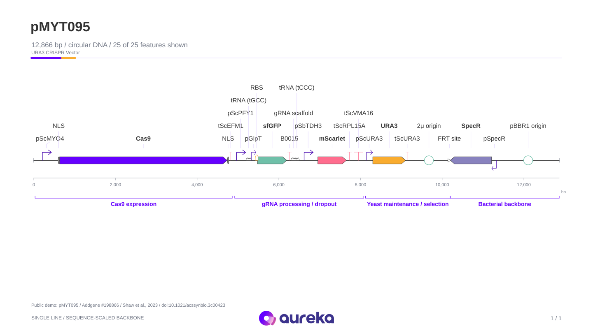
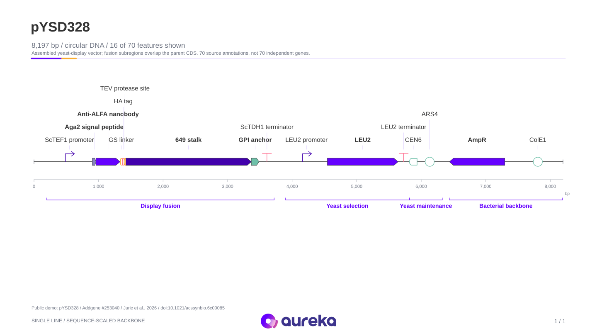

# AuraConstruct

**DNA sequence files to clear genetic construct illustrations and editable PowerPoint modules.**



Import a GenBank, SnapGene, FASTA, EMBL, or plain DNA file. Review its annotations, choose SBOL Visual glyphs, and export a figure whose labels and glyph paths remain native PowerPoint objects. AuraConstruct is an illustration tool for presentations, teaching, and figure preparation.

## Start the studio

Python 3.10 or newer:

```bash
git clone https://github.com/Drjackxiaoyuchen/auraconstruct.git
cd auraconstruct
python3 -m venv .venv
source .venv/bin/activate
pip install -e .
auraconstruct serve
```

Open [the local studio](http://127.0.0.1:8741). On macOS, `launch.command` starts the same app and sets up the environment on first launch. The interface has no external fonts, analytics, or remote sequence services. Uploaded sequences stay in local browser/server memory until you export or close the session. Saved project JSON and GenBank exports include the DNA sequence.

1. Drop one or more files, or select a public toolkit plasmid and choose **Load public example**.
2. Review the feature table. Edit labels, roles, colors, module names, and visibility.
3. **Single line** keeps the entire construct on one continuous backbone, with labels above and a bp axis and module brackets below. Choose **Wrapped** for full annotation callouts across pages, or **Coordinates** for separate interval lanes.
4. Export **PowerPoint**. Select a named feature group and ungroup it to edit individual glyph strokes or text. Copy groups into your own deck.
5. **Save project** preserves all loaded constructs and illustration settings. **Open project** restores them. **Export all constructs** combines figures into one PPTX.

The studio includes real public **YTK pYTK001**, **MYT pMYT001/pMYT075/pMYT095**, and **YSD 2.0 pYSD891/pYSD328** examples, with source links, checksums and recorded display curation. The random-DNA fixture remains for tests. See [public demo provenance and data licenses](docs/PUBLIC_DEMOS.md).

## Complex construct demo



**pYSD328: 8,197 bp, 70 source annotations**, including an assembled nanobody-display fusion, overlapping protein regions, tags, primers, yeast selection/maintenance and a reverse-strand bacterial cassette. These are 70 annotations, not 70 separate genes. Two presets offer a 16-part presentation selection and all 70 annotations. Both remain on one backbone in the default **Single line** view.

[Download the editable single-line demos](examples/AuraConstruct_Single_Line_Demos.pptx): Cas9/gRNA, selected YSD fusion and all 70 YSD annotations, each on one slide. The [wrapped detail deck](examples/AuraConstruct_Complex_YSD328.pptx) remains available for longer callouts. [Source and display decisions](docs/PUBLIC_DEMOS.md#complex-construct-demo).

With the studio running, [open the single-line Cas9/gRNA demo](http://127.0.0.1:8741/?demo=myt095&layout=singleline), [selected YSD fusion](http://127.0.0.1:8741/?demo=ysd328&layout=singleline) or [all 70 annotations](http://127.0.0.1:8741/?demo=ysd328-all&layout=singleline). These links load the bundled public example automatically.

## What works in v0.5

| Area | Support |
| --- | --- |
| Sequence input | GenBank (`.gb`, `.gbk`, `.genbank`, and content-detected variants), SnapGene (`.dna`), FASTA, EMBL, IUPAC DNA text; gzip-compressed input |
| Multiple records | Multiple files and multiple GenBank/FASTA records |
| Locations | Forward/reverse strands, joined segments, circular-origin crossings, per-segment strands; fuzzy locations retain their original location string |
| Annotation | Existing features; exact matches against user reference FASTA/GenBank/SnapGene/EMBL; optional local pLannotate |
| Illustration | SBOL Visual sequence-feature glyph subset, module brackets, Aureka/paper/colorblind/monochrome palettes, pagination, feature hiding |
| Export | Native editable PPTX, SVG or a ZIP of SVG pages, annotated GenBank, project JSON |
| Automation | CLI and a documented local HTTP API |

Features include promoters, ribosome entry sites, CDSs, terminators, origins, operators, primer sites, assembly scars, recombination sites, non-coding RNA, polyA sites, and unspecified features. See [glyph semantics](docs/SBOL_VISUAL.md).

## Aureka appearance

New sessions and CLI exports use Aureka’s 2026 purple, yellow, mint and pink palette, Arial typography, white scientific canvas, and original wordmark. The exported PPTX theme carries the same accent colors. [Style reference](docs/AUREKA_STYLE.md).

## Annotation

Existing GenBank/SnapGene annotations remain available without installing an annotation engine. Role assignments prefer feature types and Sequence Ontology terms. Label-based guesses are visibly marked `label-heuristic` in the table. Changing a glyph changes the illustration role, not the underlying DNA.

For unannotated DNA, use **Match reference parts** with a trusted local part library, or install pLannotate. The reference matcher searches exact sequences on both strands and across the origin of circular DNA. It does not identify distant homologs or predict novel genes. Predicted annotations retain their source and do not replace imported features.

[pLannotate setup and annotation behavior](docs/ANNOTATION.md)

## Detailed annotation

Single-line maps use compact labels and retain complete callouts in the review table, project and speaker notes. Choose **Wrapped → Detailed** to place source coordinates, length, strand, homology-arm/barcode/primer context, source notes and editable callouts alongside each SBOL glyph. [Detailed annotation behavior and coordinate limits](docs/DETAILED_ANNOTATIONS.md).

## Command line

```bash
auraconstruct export plasmid.gb -o figure.pptx
auraconstruct export plasmid.gb -o one-line.pptx --layout singleline
auraconstruct export plasmid.gb -o full-callouts.pptx --layout schematic --detail detailed
auraconstruct export vector.dna -o figure.svg --palette colorblind
auraconstruct export construct.fa -o figure.pptx --reference trusted-parts.gb --topology circular
auraconstruct export construct.fa -o figure.pptx --annotate plannotate --topology linear
auraconstruct export *.gb -o all-constructs.pptx --coordinates
auraconstruct export annotated.gb -o coordinates.pptx --layout proportional
```

For multiple SVG pages, the CLI writes numbered SVG files. The browser app downloads a ZIP. **Single line** is the CLI, API and studio default: its backbone and CDS spans follow sequence coordinates, small symbols have minimum readable sizes, labels occupy tiers above the line, and explicit module spans appear below it. Its axis uses sequence-boundary positions from 0 to sequence length. Feature intervals in notes/table remain 1-based inclusive. **Wrapped** schematic order follows sequence coordinates with lengths not to scale. Coordinate mode puts exact colored interval tracks on a shared bp axis, using lanes to separate overlapping features on the same DNA molecule.

[Editable detailed MYT examples](examples/AuraConstruct_Detailed_MYT_Annotations.pptx) show donor arms, barcodes, primer sites and Cas9/gRNA annotations. [Editable public demo examples](examples/AuraConstruct_Aureka_Public_Demos.pptx) combine the YTK, MYT and YSD 2.0 figures.

## Design references

The closest reference is **[DNAplotlib](https://github.com/VoigtLab/dnaplotlib)**, hosted by the Voigt lab, with the associated paper by Der et al., *ACS Synthetic Biology* (2017), [DOI: 10.1021/acssynbio.6b00252](https://doi.org/10.1021/acssynbio.6b00252). Its gallery demonstrates programmable genetic diagrams, SBOL glyphs and variant layouts. [Cello](https://www.nist.gov/publications/genetic-circuit-design-automation), described by Nielsen et al. (2016), is a related reference for separating circuit diagrams from DNA designs.

AuraConstruct draws its own native paths. No Voigt paper figures or DNAplotlib source code are redistributed. The visual target is clear part hierarchy, restrained color, consistent linework, readable labels and generous spacing. This does not establish which software made every figure in the Voigt literature.

The useful gap is the editable PPTX workflow. The projects reviewed document strong annotation or vector-figure capabilities; this review did not establish a direct native PowerPoint module export equivalent. [Reference comparison and visual rationale](docs/RESEARCH.md).

## Scope and current limits

- SBOL **Visual** is a graphical notation. This release implements a subset of its sequence-feature conventions; it is not an audited full-standard implementation or an SBOL RDF/JSON-LD serializer.
- No gene function, regulatory interaction, promoter strength, expression level or biological performance is inferred from drawing order.
- Circular DNA is displayed as a linearized construct. Joined locations retain their ordered segments. The schematic sorts by the smallest segment coordinate, so origin-crossing features need coordinate-view review.
- Fuzzy coordinates use integer bounds for drawing. The project retains a fuzzy flag and the imported location string; GenBank export writes those integer locations with the original string in a qualifier.
- Single-line maps never wrap or split a construct across slides. Dense labels use tiers above the same backbone. Parent outlines preserve overlapping regions; one group can contain multiple joined segments. If labels or module brackets exceed readable space, the app asks you to shorten labels or hide secondary features instead of wrapping the backbone. Full labels and callouts remain in project/GenBank/speaker notes.
- Wrapped overview maps paginate at 16 features per slide; wrapped detailed maps use eight. Coordinate mode uses three or two lanes per slide respectively.
- Input limit: 20 MB after decompression. This tool targets constructs and plasmids, rather than whole-genome annotation or assembly analysis.
- SnapGene sequence and features are imported through Biopython. Proprietary history, enzyme catalogs and cloning operations are outside this version.
- pLannotate integration requires its own installed tools and databases. The adapter is tested with a controlled executable result; a live pLannotate database run was not performed in the development environment.

## Development

```bash
pip install -e '.[dev]'
pytest -q
python scripts/build_examples.py
```

Tests exercise real binary SnapGene packets, coordinate round trips, joined features, both-strand matching, native PPTX paths/groups/text, package relationships, pagination and the HTTP workflow. CI covers Python 3.10, 3.12 and 3.13. Local validation additionally parsed and exported 96 workspace MYT GenBank files containing 1,011 features; these source files are not included in the repository.

[Architecture and local API](docs/ARCHITECTURE.md) · [Roadmap](docs/ROADMAP.md) · [MIT license](LICENSE)
