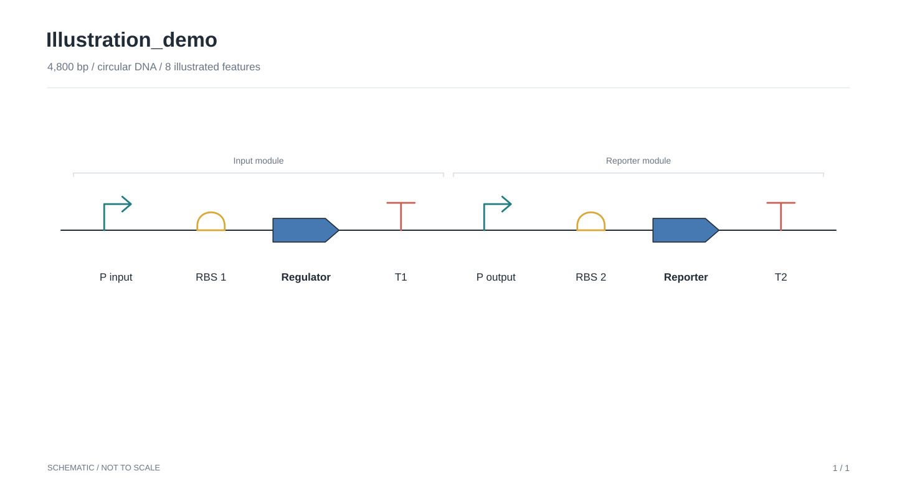

# AuraConstruct

**DNA sequence files to clear genetic construct illustrations and editable PowerPoint modules.**



Import a GenBank, SnapGene, FASTA, EMBL, or plain DNA file. Review its annotations, choose SBOL Visual glyphs, and export a figure whose labels and glyph paths remain native PowerPoint objects. AuraConstruct is an illustration tool for presentations, teaching, and figure preparation.

## Start the studio

Python 3.10 or newer:

```bash
git clone https://github.com/Drjackxiaoyuchen/auraconstruct.git
cd auraconstruct
python3 -m venv .venv
source .venv/bin/activate
pip install -e .
auraconstruct serve
```

Open [the local studio](http://127.0.0.1:8741). On macOS, `launch.command` starts the same app and sets up the environment on first launch. The interface has no external fonts, analytics, or remote sequence services. Uploaded sequences stay in local browser/server memory until you export or close the session. Saved project JSON and GenBank exports include the DNA sequence.

1. Drop one or more files, or choose **Explore an example**.
2. Review the feature table. Edit labels, roles, colors, module names, and visibility.
3. Choose **Schematic** for a presentation or **Coordinates** to check positions.
4. Export **PowerPoint**. Select a named feature group and ungroup it to edit individual glyph strokes or text. Copy groups into your own deck.
5. **Save project** preserves all loaded constructs and illustration settings. **Open project** restores them. **Export all constructs** combines figures into one PPTX.

The bundled example uses random DNA and illustrative annotations. It does **not** contain functional sequences for the labeled parts.

## What works in v0.1

| Area | Support |
| --- | --- |
| Sequence input | GenBank (`.gb`, `.gbk`, `.genbank`, and content-detected variants), SnapGene (`.dna`), FASTA, EMBL, IUPAC DNA text; gzip-compressed input |
| Multiple records | Multiple files and multiple GenBank/FASTA records |
| Locations | Forward/reverse strands, joined segments, circular-origin crossings, per-segment strands; fuzzy locations retain their original location string |
| Annotation | Existing features; exact matches against user reference FASTA/GenBank/SnapGene/EMBL; optional local pLannotate |
| Illustration | SBOL Visual sequence-feature glyph subset, module brackets, paper/colorblind/monochrome palettes, pagination, feature hiding |
| Export | Native editable PPTX, SVG or a ZIP of SVG pages, annotated GenBank, project JSON |
| Automation | CLI and a documented local HTTP API |

Features include promoters, ribosome entry sites, CDSs, terminators, origins, operators, primer sites, assembly scars, recombination sites, non-coding RNA, polyA sites, and unspecified features. See [glyph semantics](docs/SBOL_VISUAL.md).

## Annotation

Existing GenBank/SnapGene annotations remain available without installing an annotation engine. Role assignments prefer feature types and Sequence Ontology terms. Label-based guesses are visibly marked `label-heuristic` in the table. Changing a glyph changes the illustration role, not the underlying DNA.

For unannotated DNA, use **Match reference parts** with a trusted local part library, or install pLannotate. The reference matcher searches exact sequences on both strands and across the origin of circular DNA. It does not identify distant homologs or predict novel genes. Predicted annotations retain their source and do not replace imported features.

[pLannotate setup and annotation behavior](docs/ANNOTATION.md)

## Command line

```bash
auraconstruct export plasmid.gb -o figure.pptx
auraconstruct export vector.dna -o figure.svg --palette colorblind
auraconstruct export construct.fa -o figure.pptx --reference trusted-parts.gb --topology circular
auraconstruct export construct.fa -o figure.pptx --annotate plannotate --topology linear
auraconstruct export *.gb -o all-constructs.pptx --coordinates
auraconstruct export annotated.gb -o coordinates.pptx --layout proportional
```

For multiple SVG pages, the CLI writes numbered SVG files. The browser app downloads a ZIP. Proportional mode places exact colored interval tracks on a shared bp axis; glyph widths have readability limits. In schematic mode, part order follows sequence coordinates and lengths are not to scale. Lanes in coordinate mode separate overlapping features on the same DNA molecule.

## Design references

The closest reference is **[DNAplotlib](https://github.com/VoigtLab/dnaplotlib)**, hosted by the Voigt lab, with the associated paper by Der et al., *ACS Synthetic Biology* (2017), [DOI: 10.1021/acssynbio.6b00252](https://doi.org/10.1021/acssynbio.6b00252). Its gallery demonstrates programmable genetic diagrams, SBOL glyphs and variant layouts. [Cello](https://www.nist.gov/publications/genetic-circuit-design-automation), described by Nielsen et al. (2016), is a related reference for separating circuit diagrams from DNA designs.

AuraConstruct draws its own native paths. No Voigt paper figures or DNAplotlib source code are redistributed. The visual target is clear part hierarchy, restrained color, consistent linework, readable labels and generous spacing. This does not establish which software made every figure in the Voigt literature.

The useful gap is the editable PPTX workflow. The projects reviewed document strong annotation or vector-figure capabilities; this review did not establish a direct native PowerPoint module export equivalent. [Reference comparison and visual rationale](docs/RESEARCH.md).

## Scope and current limits

- SBOL **Visual** is a graphical notation. This release implements a subset of its sequence-feature conventions; it is not an audited full-standard implementation or an SBOL RDF/JSON-LD serializer.
- No gene function, regulatory interaction, promoter strength, expression level or biological performance is inferred from drawing order.
- Circular DNA is displayed as a linearized construct. Joined locations retain their ordered segments. The schematic sorts by the smallest segment coordinate, so origin-crossing features need coordinate-view review.
- Fuzzy coordinates use integer bounds for drawing. The project retains a fuzzy flag and the imported location string; GenBank export writes those integer locations with the original string in a qualifier.
- Dense maps paginate at 16 features per schematic slide or three coordinate lanes per slide. Very long display labels may shorten; full labels remain in the project, GenBank and speaker notes.
- Input limit: 20 MB after decompression. This tool targets constructs and plasmids, rather than whole-genome annotation or assembly analysis.
- SnapGene sequence and features are imported through Biopython. Proprietary history, enzyme catalogs and cloning operations are outside this version.
- pLannotate integration requires its own installed tools and databases. The adapter is tested with a controlled executable result; a live pLannotate database run was not performed in the development environment.

## Development

```bash
pip install -e '.[dev]'
pytest -q
```

Tests exercise real binary SnapGene packets, coordinate round trips, joined features, both-strand matching, native PPTX paths/groups/text, package relationships, pagination and the HTTP workflow. CI covers Python 3.10, 3.12 and 3.13. Local validation additionally parsed and exported 96 workspace MYT GenBank files containing 1,011 features; these source files are not included in the repository.

[Architecture and local API](docs/ARCHITECTURE.md) · [Roadmap](docs/ROADMAP.md) · [MIT license](LICENSE)
